<div align="center">

# glance-explainer

**Explainer pages for readers with ADHD or a short working memory.**

A Claude Code plugin that turns what your agent did into one page you can read in minutes:<br>
the answer first, a picture in every chapter, one question when you must decide, and checked before it reaches you.

[](https://github.com/ariasr47/glance-explainer/actions/workflows/ci.yml)
[](CHANGELOG.md)
[](LICENSE)
[](https://agentskills.io)

**[See live examples](https://ariasr47.github.io/glance-explainer/)** · [Install](#install) · [What it makes](#what-it-makes) · [Roadmap](ROADMAP.md) · [Changelog](CHANGELOG.md)

<picture>
  <source media="(prefers-color-scheme: dark)" srcset="docs/images/hero-dark.png">
  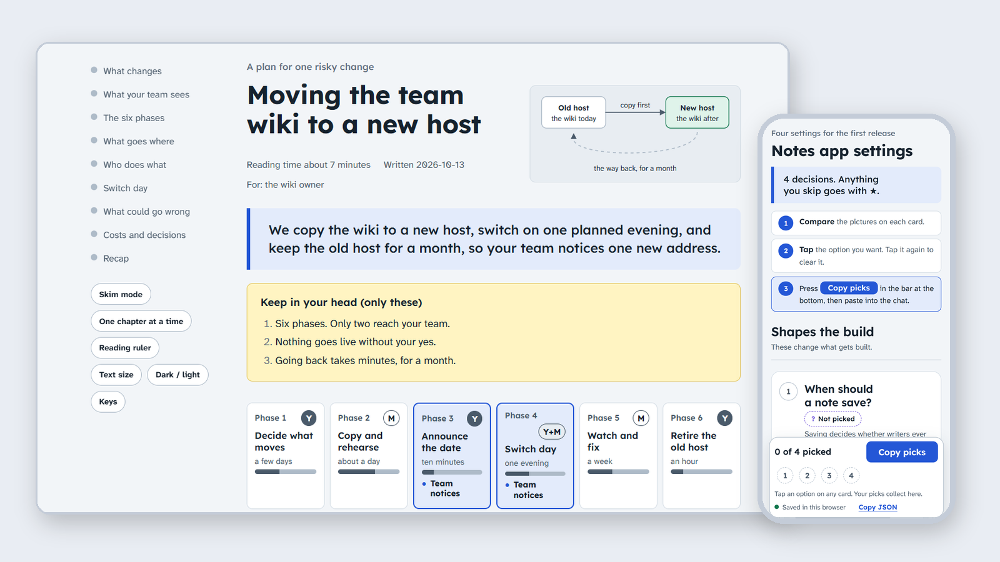
</picture>

</div>

## Why

Agents write more than anyone can read: long summaries, plans, diffs and status reports. When you have to approve something or choose between options, a wall of text costs attention you may not have, especially with ADHD or a short working memory.

Every page this plugin makes has the same shape:

1. **The answer**, in one sentence, right under the title.
2. **At most three facts** to keep in your head.
3. **At a glance**: the page's own picture on the first screen, such as a status board, the steps of a procedure or the options side by side.
4. **One idea per chapter**, each with a picture, each closing with one line to remember.
5. **A recap**, and **one question** only when a decision is needed, with the recommended choice marked and what happens if you do nothing.

## What makes it different

- **Checked before you see it.** A checker script runs on every page and the agent fixes each failure first: answer length, at most three keep facts, a picture per chapter, text contrast of 4.5 to 1 in light and dark, status colours that always carry a glyph, diagram labels readable on a phone, and the rules of each page type. In Claude Code a hook runs it at the end of every turn that wrote a page, so it cannot be skipped.
- **The reader is in control.** A dark or light switch sits beside one Reading tools button, which holds skim mode, one chapter at a time, a reading ruler, text size and keyboard shortcuts. Each chapter can be read aloud, and a link resumes where you left off. Nothing moves unless you ask.
- **Answer by tapping.** A decision page can end in tap-to-answer fields, and a ballot puts one decision per card, pictured or in words, with a Pick all ★ button and warning chips such as "Can't undo". You copy every answer back to the agent in one paste, and a gather page collects answers from several readers, which a merge tool combines.
- **One file, offline, private.** Each page is a single HTML file. No server, no account, no tracking. It works on a phone and prints cleanly.

## See it

Every kind of page the plugin makes has a working example. Open one, tap its answers, switch it to dark, or read it on your phone. All of them are on the [examples page](https://ariasr47.github.io/glance-explainer/examples.html), grouped by the job you have.

<table>
<tr><td width="33%" valign="top"><a href="https://ariasr47.github.io/glance-explainer/examples/decision.html">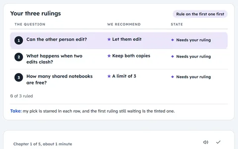</a><br><b><a href="https://ariasr47.github.io/glance-explainer/examples/decision.html">Decision</a></b><br>Three rulings, answered by tapping</td><td width="33%" valign="top"><a href="https://ariasr47.github.io/glance-explainer/examples/ballot.html">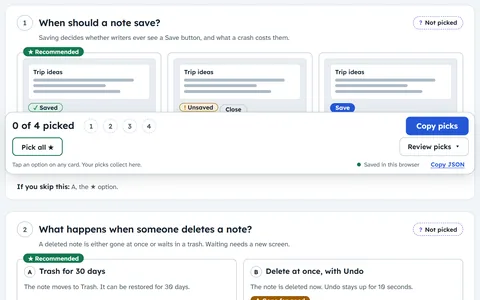</a><br><b><a href="https://ariasr47.github.io/glance-explainer/examples/ballot.html">Ballot</a></b><br>Four decisions on one phone screen</td><td width="33%" valign="top"><a href="https://ariasr47.github.io/glance-explainer/examples/compare.html">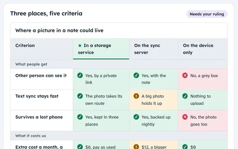</a><br><b><a href="https://ariasr47.github.io/glance-explainer/examples/compare.html">Compare</a></b><br>Three options against five criteria</td></tr>
<tr><td width="33%" valign="top"><a href="https://ariasr47.github.io/glance-explainer/examples/spec.html">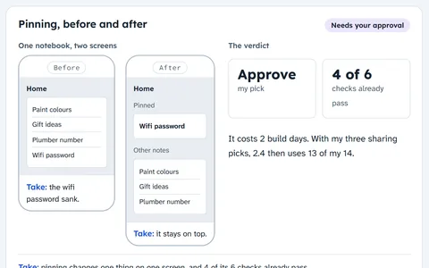</a><br><b><a href="https://ariasr47.github.io/glance-explainer/examples/spec.html">Spec</a></b><br>Approve or hold one feature</td><td width="33%" valign="top"><a href="https://ariasr47.github.io/glance-explainer/examples/playbook.html">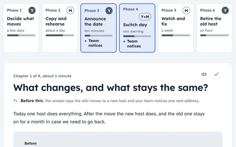</a><br><b><a href="https://ariasr47.github.io/glance-explainer/examples/playbook.html">Playbook</a></b><br>A plan for one risky change</td><td width="33%" valign="top"><a href="https://ariasr47.github.io/glance-explainer/examples/status.html">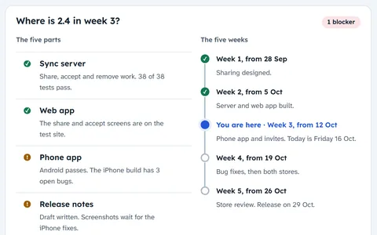</a><br><b><a href="https://ariasr47.github.io/glance-explainer/examples/status.html">Status</a></b><br>Where a release stands, and its blocker</td></tr>
<tr><td width="33%" valign="top"><a href="https://ariasr47.github.io/glance-explainer/examples/portfolio.html">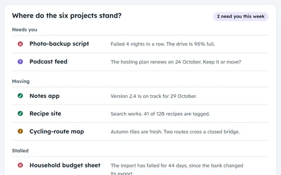</a><br><b><a href="https://ariasr47.github.io/glance-explainer/examples/portfolio.html">Portfolio</a></b><br>Six projects, the urgent ones first</td><td width="33%" valign="top"><a href="https://ariasr47.github.io/glance-explainer/roadmap.html">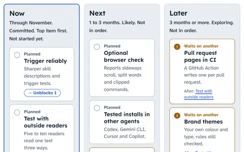</a><br><b><a href="https://ariasr47.github.io/glance-explainer/roadmap.html">Roadmap</a></b><br>This plugin's now, next and later</td><td width="33%" valign="top"><a href="https://ariasr47.github.io/glance-explainer/examples/release.html">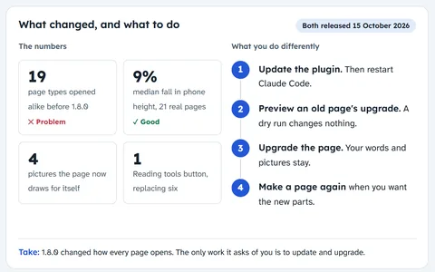</a><br><b><a href="https://ariasr47.github.io/glance-explainer/examples/release.html">Release</a></b><br>What shipped in 1.8.0 and 1.8.1</td></tr>
<tr><td width="33%" valign="top"><a href="https://ariasr47.github.io/glance-explainer/examples/incident.html">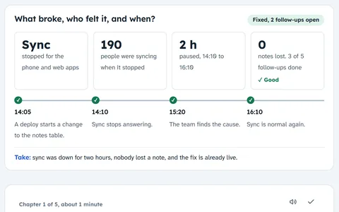</a><br><b><a href="https://ariasr47.github.io/glance-explainer/examples/incident.html">Incident</a></b><br>What broke, why, and what stops a repeat</td><td width="33%" valign="top"><a href="https://ariasr47.github.io/glance-explainer/examples/handover.html">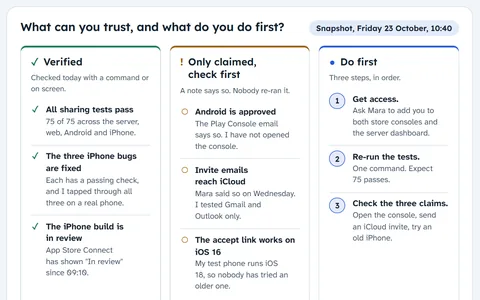</a><br><b><a href="https://ariasr47.github.io/glance-explainer/examples/handover.html">Handover</a></b><br>Work in flight, claims kept apart</td><td width="33%" valign="top"><a href="https://ariasr47.github.io/glance-explainer/examples/explainer.html">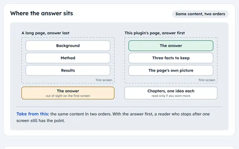</a><br><b><a href="https://ariasr47.github.io/glance-explainer/examples/explainer.html">Explainer</a></b><br>Why every page opens with the answer</td></tr>
<tr><td width="33%" valign="top"><a href="https://ariasr47.github.io/glance-explainer/examples/teach.html">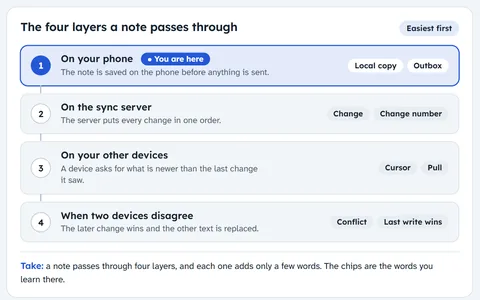</a><br><b><a href="https://ariasr47.github.io/glance-explainer/examples/teach.html">Teach</a></b><br>A system in layers, for a newcomer</td><td width="33%" valign="top"><a href="https://ariasr47.github.io/glance-explainer/examples/tour.html">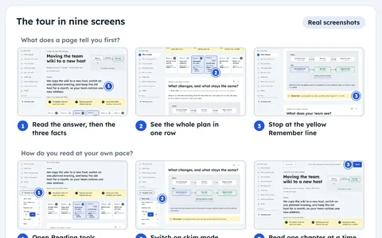</a><br><b><a href="https://ariasr47.github.io/glance-explainer/examples/tour.html">Tour</a></b><br>How to read a page, on real screens</td><td width="33%" valign="top"><a href="https://ariasr47.github.io/glance-explainer/examples/research.html">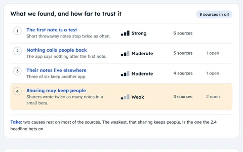</a><br><b><a href="https://ariasr47.github.io/glance-explainer/examples/research.html">Research</a></b><br>Findings and how sure each one is</td></tr>
<tr><td width="33%" valign="top"><a href="https://ariasr47.github.io/glance-explainer/examples/field-guide.html">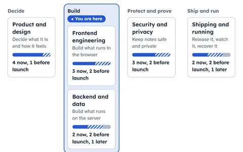</a><br><b><a href="https://ariasr47.github.io/glance-explainer/examples/field-guide.html">Field guide</a></b><br>A reference to look things up in</td><td width="33%" valign="top"><a href="https://ariasr47.github.io/glance-explainer/examples/atlas/index.html">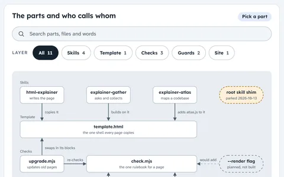</a><br><b><a href="https://ariasr47.github.io/glance-explainer/examples/atlas/index.html">Atlas</a></b><br>How this repository fits together</td><td width="33%" valign="top"><a href="https://ariasr47.github.io/glance-explainer/examples/runbook.html">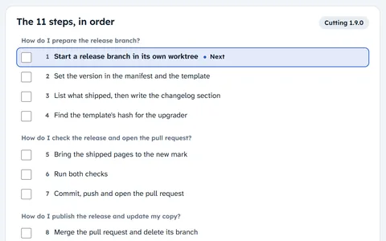</a><br><b><a href="https://ariasr47.github.io/glance-explainer/examples/runbook.html">Runbook</a></b><br>A release in 11 checked steps</td></tr>
<tr><td width="33%" valign="top"><a href="https://ariasr47.github.io/glance-explainer/examples/pr.html">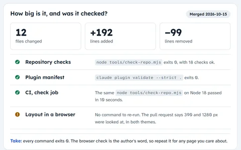</a><br><b><a href="https://ariasr47.github.io/glance-explainer/examples/pr.html">Pull request</a></b><br>A change, before you read the diff</td><td width="33%" valign="top"><a href="https://ariasr47.github.io/glance-explainer/examples/questionnaire.html">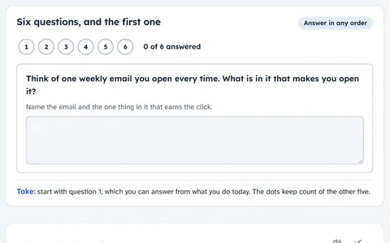</a><br><b><a href="https://ariasr47.github.io/glance-explainer/examples/questionnaire.html">Questionnaire</a></b><br>Six questions, answers in one paste</td><td width="33%" valign="top"><a href="https://ariasr47.github.io/glance-explainer/">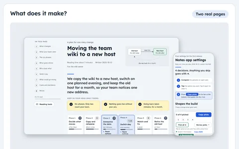</a><br><b><a href="https://ariasr47.github.io/glance-explainer/">Public</a></b><br>The site home: promises, with proof</td></tr>
</table>

Examples about the notes app use made-up data. The plugin's own pages (release, pull request, runbook, explainer, tour, atlas, roadmap) use real facts from this repository. Every page passes the plugin's checker. The [gallery](https://ariasr47.github.io/glance-explainer/gallery.html) shows each building block on its own.

Every example also comes in Japanese (日本語版), written to read natively rather than word for word. The links are at the end of the [examples page](https://ariasr47.github.io/glance-explainer/examples.html#recap).

## Install

In Claude Code:

```text
/plugin marketplace add ariasr47/glance-explainer
/plugin install glance-explainer@glance-explainer
```

Restart Claude Code, then ask: *"Make a glance explainer for this spec."*

Installed it before 2.0.0, when it was called html-explainer? [Move over in four commands](docs/install.md#moving-from-html-explainer).

Node 18 or newer runs the checker; nothing else installs. **[The install guide](docs/install.md)** covers installing from a shell, setting it up for a whole team, updating, other agents such as Codex, Cursor, Gemini CLI and Copilot, and what to do when a skill does not start.

## Use

Ask in plain words. The agent picks the page type, writes the page from the template, runs the checker, saves it under `docs/explainers/` and gives you the link.

| When you need to | Ask it like this | Page types |
|---|---|---|
| Decide | "Make a glance explainer for the three decisions you need from me." | decision, compare |
| Know where things stand | "Explain where we are with the project as a glance explainer." | status, release, incident, pr, portfolio |
| Approve a plan | "Turn this spec into a glance explainer I can approve." | spec, roadmap, research, playbook |
| Hand over or teach | "Write a handover page for whoever picks this up." | handover, teach, tour |
| Look things up | "Make a field guide to this field that I can search later." | field-guide |
| Follow a procedure | "Make a runbook page for the release steps." | runbook |
| Tell customers | "Explain to customers what happens to the file they upload." | public |
| Ask a group | "Make a page that asks my team these questions and collects their answers." | gather (11 modes, including ballot) |
| Map a codebase | "Write a backend architecture atlas for this repository." | atlas |

To call a skill directly, type `/glance-explainer:glance-explainer <topic>`, `/glance-explainer:explainer-gather <topic>` or `/glance-explainer:explainer-atlas <layer>`.

To bring a page made with an older release up to the current design, ask: *"Upgrade this page to the current glance-explainer design."* The agent runs `upgrade.mjs`, which keeps your content and saves a backup.

## What it makes

<details>
<summary><b>Seventeen page types</b>, each with its own chapters, required components and checker rules</summary>

| Type | When |
|---|---|
| decision | You must rule on options a session poses. |
| status | You need to know where things stand and what comes next. |
| spec | You must approve a feature before it is built. |
| release | You need to know what shipped and what to do differently now. |
| research | You need findings and how far to trust each one. |
| handover | A session or a person takes over work in progress. |
| portfolio | You own several projects and need all of them at once. |
| public | The reader is a customer who needs to know what the product does for them. |
| teach | A newcomer must learn one system well enough to work with it. |
| incident | Something broke: what happened, why, what is fixed, and what stops a repeat. |
| pr | A reviewer must understand a pull request before reading its diff. |
| runbook | Someone follows a procedure and must know after each step whether it worked. |
| compare | You choose between options measured on the same few criteria. |
| roadmap | What is under way now, next and later, and what depends on what. |
| tour | How a product works, step by step, on its real screens. |
| playbook | You rule on a plan for one risky, multi-step change. |
| field-guide | You need to get oriented in a whole field once, then look things up. |

Full definitions: [`skills/glance-explainer/references/types.md`](skills/glance-explainer/references/types.md).
</details>

<details>
<summary><b>Eleven ways to ask and collect</b> with explainer-gather</summary>

collect, confirm, choose, ballot, prioritise, annotate, check, protocol, pilot, readout and recurring. Answers save in the reader's browser until they copy them as Markdown or JSON or download a file. [`merge.html`](skills/explainer-gather/assets/merge.html) combines any number of copies, grouped by question, and exports Markdown, JSON or CSV. Details: [`references/modes.md`](skills/explainer-gather/references/modes.md).
</details>

<details>
<summary><b>Architecture atlases</b> with explainer-atlas</summary>

A folder with `index.html`, `atlas.css` and `atlas.js` that maps one layer of a codebase: backend, frontend, data, infrastructure or the whole system. Every claim that names code carries a file and line anchor, current, dormant and target states stay visually apart, and [`anchors.mjs`](skills/explainer-atlas/scripts/anchors.mjs) confirms each anchor exists at the recorded revision.
</details>

<details>
<summary><b>Japanese pages</b></summary>

With `<html lang="ja">` the template switches to BIZ UDPGothic, a looser line height, strict line breaking and no italics, and the checker counts characters instead of words. [`translate.mjs`](skills/glance-explainer/scripts/translate.mjs) turns a finished English page into a Japanese one with the same layout and question ids, so answers in both languages merge.
</details>

## Design in one paragraph

Cool fog paper, deep navy ink, one cobalt for "you are here", four meaning colours (green done, amber caution, red blocked, purple your choice), and yellow for anything you are asked to remember. Colour is never the only signal. Lexend for headings, Atkinson Hyperlegible Next for body text, 18 px base, 62-character lines, left aligned. Dark mode follows your system. The full system is in [`references/design-system.md`](skills/glance-explainer/references/design-system.md).

## What is in the repository

| Path | What it holds |
|---|---|
| [`skills/glance-explainer/`](skills/glance-explainer/) | The core skill: template, gallery, checker, page types and writing rules |
| [`skills/explainer-gather/`](skills/explainer-gather/) | Pages that ask and collect, the merge tool and the ballot example |
| [`skills/explainer-atlas/`](skills/explainer-atlas/) | Architecture atlases and the anchor checker |
| [`docs/`](docs/) | The public site, the install guide, screenshots and planning history |
| [`.claude-plugin/`](.claude-plugin/) | Plugin and marketplace manifests |
| [`tools/check-repo.mjs`](tools/check-repo.mjs) | The checks CI runs on every change |

Each skill folder is self-contained in the [Agent Skills](https://agentskills.io) layout. [CONTRIBUTING.md](CONTRIBUTING.md) explains how to change the design, run the checks and release.

## Roadmap and feedback

Next: pages get tested with outside readers, and the plugin gets a directory listing. See [ROADMAP.md](ROADMAP.md).

If you try a page, [say how it went](https://github.com/ariasr47/glance-explainer/issues/new?template=feedback.yml), especially if you or your reader has ADHD. That feedback decides what gets built.

## What it runs, sends and fetches

Nothing in the plugin sends data anywhere, and none of its scripts use the network.

- **The skills** run their own Node scripts on your machine, from the skill folders. `check.mjs` checks a page, `upgrade.mjs` brings an older page to the current design, `translate.mjs` and `assemble.mjs` build pages, and the atlas skill's `anchors.mjs` reads the repository with `git` to confirm each file and line anchor. They read and write only the pages and files the task names.
- **The hook** runs `hooks/explainer-check.mjs` with Node in Claude Code and Cowork; chat on claude.ai ignores it. When you send a prompt it notes the time. After a Write or Edit it notes any explainer page saved. When the turn ends it runs the checker on those pages and asks the agent to fix any failure. It keeps one small state file per session in the system's temporary folder, reads `git status` to find pages, and never touches the network.
- **The pages** are single HTML files that load no scripts from elsewhere. Opened online, they load fonts from Google Fonts (`fonts.googleapis.com` and `fonts.gstatic.com`), which sees the reader's IP address as with any web font; offline they use system fonts. A page remembers the reader's settings, reading place, picks and draft answers in that browser's own storage. Answers leave the browser only when the reader copies them.

## Licence

MIT. Fonts load from Google Fonts under the SIL Open Font License and are optional; pages fall back to system fonts.
